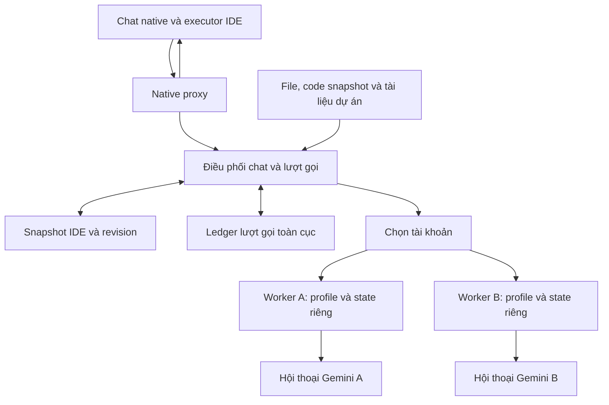

# Kế hoạch nâng cấp Antigravity – Gemini Web

Ngày lập: 16/10/2026. Baseline: native revision 22, browser fingerprint 13.

Trạng thái: **kế hoạch đề xuất để triển khai theo giai đoạn**. Việc lập tài liệu này không đồng nghĩa các tính năng bên dưới đã được triển khai hoặc nghiệm thu. Kế hoạch mở rộng phần native/browser của [kế hoạch nền](IMPLEMENTATION_PLAN.md); giữ các ranh giới executor, ownership và phục hồi trong [ADR 0009](adr/0009-native-conversation-streaming-cancellation.md) và [ADR 0010](adr/0010-native-context-updates.md).

Cập nhật triển khai: P0 có fixture evidence; P1/P2 đang nghiệm thu sau bản vá an toàn revision 23. P3 và P4–P8 giữ nguyên phạm vi bên dưới. Thao tác verify một tài khoản và test caller tổng hợp không thay cho handoff hai tài khoản hoặc executor IDE thật.

Mốc source mới nhất 18/10: native 36 / worker 23. P5 có lifecycle/TTL thật với browser giả lập; P6a/P6b có registry/CLI/UI nguồn dự án, chưa nghiệm thu selection bằng chooser Windows thật hoặc adapter Web. P8a sửa bound cleanup/ownership leak và shutdown, có before/after pool probe + 12 ca kiểm thử mới. Runtime chính còn 29/manual chờ người dùng xác minh Google. Đây là cập nhật tiến độ; không đóng các gate P1–P8 chưa đạt.

## 1. Kết quả người dùng cần nhận được

Người dùng tiếp tục làm việc trong **một đoạn chat native của IDE**, có thể chọn tài khoản Gemini A/B/C, quay lại tài khoản trước và giữ lịch sử công việc. Mỗi tài khoản có phiên đăng nhập riêng; việc đổi tài khoản không làm bridge gắn nhầm hội thoại, gửi trùng yêu cầu hoặc phát lại thao tác đã thực hiện.

Ngữ cảnh dài phải được truyền đủ và có kiểm chứng. Các nguồn như file, repository, Gems và Notebooks giúp cấp tài liệu cho model. IDE tiếp tục quyết định workspace, tool inventory, approvals và thực thi đọc/sửa/chạy lệnh.

Các kết quả phải phân biệt rõ:

- Chat và lịch sử hiển thị trong IDE.
- Hội thoại Web riêng của từng tài khoản.
- Snapshot ngữ cảnh IDE đang cung cấp.
- Bằng chứng local, browser thật và executor IDE thật.

Giữ lịch sử trong IDE không đòi hỏi các tài khoản dùng chung một URL Gemini. Dữ liệu nội bộ không được IDE cung cấp, trí nhớ ẩn của model và phần lịch sử đã bị IDE loại bỏ không được coi là có thể phục hồi nguyên trạng.

## 2. Baseline đã xác minh và khoảng trống

| Hạng mục | Hiện có | Cần làm tiếp |
|---|---|---|
| Native provider | Proxy loopback, functionCall/functionResponse, stream/cancel, nonce và Ajv validation | Nghiệm thu lại executor/UI trên bản nâng cấp |
| Context | Snapshot đầy đủ trong RAM, append/patch/replace theo revision | Tách revision theo tài khoản và loại hội thoại |
| Dung lượng | Cap native 262.144 ký tự; tin Web 28.000; fragment payload 27.000 | Không xem cap editor đã quan sát là context window của model |
| Cache revision 22 | Thu hồi kết quả, giữ dấu chống gửi lặp; cache tool schemas | Kiểm tra vận hành dài hạn và chiến lược ledger lâu dài |
| Cache kết quả | Native/MCP giữ khoảng 32 kết quả nhàn rỗi, TTL lazy 10 phút | Native có trần 65.536 identity/process; MCP ledger bền vững còn trần 2.048 tin Web |
| Tài khoản | Một backend connection, một profile mặc định; readiness biết signed_in | Chưa có registry/router, chưa ràng buộc conversation với danh tính Gemini |
| Context dài live | Revision 21 từng PASS fixture 78.642 ký tự | Revision 22 lỗi ACK; lượt đối chứng thêm sleep 1 giây cũng lỗi; chưa xác định nguyên nhân |
| Live ngắn | Revision 22 PASS vòng tool → functionResponse → final bằng caller tổng hợp | Không thay cho nghiệm thu tool thực thi trong IDE |
| Kiểm thử baseline | Build/typecheck và 125 kiểm thử liên quan PASS | Là snapshot trước triển khai kế hoạch, không phải chứng nhận cho bản tương lai |

Bằng chứng: [revision 22](evidence/g4-native-runtime-optimization-validation.md), [context dài revision 21](evidence/g4-native-context-delivery-validation.md), [native đọc file trong IDE trước đây](evidence/g4-native-retained-tab-validation.md).

Chẩn đoán ngày 16/10: request đang `persistent_rebind_after_restart`, lỗi ở `checkpoint`, `delivery=not_sent`. URL được cache không có tab mở tương ứng; Gemini hiện signed_in ở `/app`. Người dùng xác nhận vừa đổi tài khoản. Code hiện chưa phân biệt tài khoản trong binding và chuyển lỗi thiếu tab thành `BROWSER_TURN_FAILED`. Đây là lỗi khôi phục phiên cần sửa trước; không quy lỗi ACK context dài về cùng nguyên nhân khi chưa có bằng chứng.

## 3. Quyết định kiến trúc

### 3.1 Một chat IDE, nhiều binding Web

Mỗi tài khoản có một browser MCP worker sở hữu profile, CDP port, receipt ledger và browser leases của mình. Native proxy giữ endpoint IDE hiện tại; router chọn worker ở phía sau. Một worker chỉ có một chủ điều khiển browser và một reservation mutation tại một thời điểm.

Launcher/CLI gửi control commands tới cùng native runtime owner. Runtime facade và renderer không tạo thêm browser controller cho profile mà worker đã sở hữu; trạng thái hiển thị lấy từ owner đó. Credential điều khiển giữ ở main/backend, không đưa vào renderer hoặc prompt.

Đợt đầu dùng chọn tài khoản thủ công, giữ tài khoản đã chọn cho chat đến khi người dùng đổi. Chỉ mở worker cần dùng; không mở sẵn nhiều Chrome khi chưa cần. Sau khi nghiệm thu A ↔ B mới thêm ưu tiên/failover; round-robin từng lượt để sau vì làm tăng số lần đồng bộ context.

### 3.2 Mô hình trạng thái đề xuất

| Đối tượng | Dữ liệu chính | Nơi lưu |
|---|---|---|
| Account | accountId nội bộ, tên hiển thị, profile/state path, CDP port, identity fingerprint, enabled, capabilities | Registry local riêng tư có version |
| Account runtime | ready/login_required/identity_mismatch/busy/unavailable/cooldown, worker identity, lý do và thời điểm quan sát | RAM; metadata cần phục hồi được chọn rõ |
| IDE conversation | caller/task scope, account đang chọn, canonical context revision | RAM và metadata phục hồi hiện có |
| Web binding | IDE conversation + accountId + browser identity epoch + loại surface, URL, target, revision đã commit, source manifest | Metadata riêng tư; snapshot trong RAM |
| Logical turn | request identity ổn định, context hash, trạng thái, account/attempt đã chọn, kết quả hoặc outcome fence | Ledger điều phối toàn cục |
| Physical attempt | worker/account, request ID browser, fragment/upload/commit, delivery và phase | Ledger worker và metadata điều phối |
| Source manifest | loại nguồn, hash/version quan sát được, thời điểm nhập, account/surface, revision liên quan | Metadata; nội dung theo chính sách snapshot |

`accountId` là ID do app cấp, không lấy tên hiển thị làm khóa duy nhất. Profile riêng là ranh giới cách ly, còn identity fingerprint giúp phát hiện người dùng đổi Google account ngay trong profile đó. Khi chỉ xác minh được signed_in mà chưa xác minh được đúng identity, không tự nhận rằng đó vẫn là tài khoản cũ.

Thiết kế khóa binding phải chừa chỗ cho chat thường, Gem và Notebook; không giả định mọi tính năng dùng cùng URL, DOM hoặc cơ chế resume.

### 3.3 Chuyển A → B → A

1. Chỉ chốt chuyển ở ranh giới lượt gọi đã kết thúc và có kết quả xác định. Nếu đang chạy, ghi lựa chọn cho lượt tiếp theo và hiển thị rõ; cancel vẫn phải có kết quả riêng.
2. Giữ nguyên chat và lịch sử IDE. Xác minh B đúng identity, model và capabilities cần dùng.
3. Nếu B chưa có binding hợp lệ, tạo hội thoại B rồi bootstrap snapshot IDE hiện tại. Nếu đã có, chỉ dùng delta khi còn base đã commit và kiểm chứng được.
4. Commit binding B sau khi phản hồi qua nonce, schema và function policy validation. Lỗi trong staging không trở thành câu trả lời hoặc tool request của IDE.
5. Khi quay lại A, cập nhật các thay đổi diễn ra trong thời gian dùng B. Nếu base A mất hoặc không còn xác minh được, tạo binding mới và bootstrap lại ở lượt mới được phép gửi.

Không giữ cửa sổ trình duyệt mở được không đồng nghĩa mất lịch sử IDE. Việc phục hồi URL cũ phải xác minh được đúng tài khoản, đúng URL và trạng thái composer. Không tự thay một request lỗi chưa rõ kết quả bằng request trên tài khoản khác.

### 3.4 Quy tắc gửi, retry và thực thi

- Logical request identity và ledger chống gửi lặp nằm phía trên router; đổi account không tạo đường vòng bỏ qua identity đã gửi.
- Chỉ failover tự động khi chứng minh được **chưa Send**, và policy người dùng đã bật cho phép chuyển. Kiểm tra lại điều kiện này tại thời điểm chuyển, không dựa vào lỗi chung hay timestamp.
- Từ khi click Send hoặc có fragment được chấp nhận mà outcome chưa xác định, giữ fence; không tự lặp ở cùng tài khoản hoặc tài khoản khác.
- Mọi callback gắn accountId, identity epoch, conversation binding và attempt ID. Callback cũ không được commit lượt hoặc binding mới.
- Chỉ response nonce hiện tại, tool được cho phép và args qua schema gốc mới tạo native functionCall. Nội dung memory/file/Gem/Notebook không cấp quyền tool.
- Tool results trong lịch sử là dữ liệu đã xảy ra. Handoff không biến chúng thành yêu cầu chạy lại.
- Retry HTTP còn cache giữ nguyên functionCall ID. Nghiệm thu riêng hành vi dedup của IDE; không tuyên bố exactly-once toàn tuyến chỉ từ kiểm thử proxy.

## 4. Truyền và duy trì ngữ cảnh

### 4.1 Nguồn dữ liệu có thẩm quyền

Snapshot do IDE cung cấp là nguồn chính cho system instructions hiện tại, ordered history, function calls/results, tool inventory và function policy. Canonicalization và hash phải xác định, giữ Unicode và mọi thay đổi/xóa của host. Nếu host đã compact lịch sử, ghi rõ phạm vi nhận được; không dựng thêm phần thiếu bằng memory.

Tài liệu dự án là lớp bổ trợ: kiến trúc, conventions, requirements, API docs và source snapshots. Mỗi nguồn cần manifest để nhận biết bản cũ. File chưa commit/local changes lấy từ IDE hoặc gói code local được chọn; GitHub không đại diện cho toàn bộ working tree.

### 4.2 Chiến lược transport

| Trường hợp | Phương án đề xuất | Điều kiện |
|---|---|---|
| Prompt nhỏ, chưa có context | Một tin text | Nhập/readback đầy đủ và xác nhận browser acceptance |
| Có base trong cùng binding | Append hoặc patch | Local reconstruct bằng đúng snapshot mới; base Web còn xác minh được |
| Snapshot lớn | Upload file text làm ứng viên ưu tiên | Chỉ bật sau spike upload/processing/retrieval/tool loop đạt |
| Tài khoản không hỗ trợ upload hoặc chưa nghiệm thu | Fragment + ACK + commit hiện tại | Bật/tắt theo capability và kết quả nghiệm thu; lỗi ACK dừng luồng |
| Nguồn kiến thức ổn định | Gem/Notebook/code import | Chỉ bổ trợ; chưa thay snapshot quyền/thực thi hiện tại |

Không tăng cap native hiện tại chỉ vì Web cho tải file lớn. Trần nhập archive 5 GB và trần upload tài liệu không phải bằng chứng về lượng context model xử lý chính xác trong một lượt.

### 4.3 Spike upload snapshot

1. Tạo file UTF-8 có version từ chính snapshot đã compile, dưới thư mục tạm riêng do task sở hữu. Ghi hash và kích thước local; không đưa credential/transport metadata vào file.
2. Chọn file qua file input/CDP trên đúng owned target. Chờ attachment hiển thị đúng và xử lý hoàn tất; nếu DOM không chứng minh được readiness thì dừng trước Send.
3. Gửi prompt điều khiển ngắn: snapshot revision, response nonce hiện tại, định dạng trả lời và yêu cầu của lượt. Phân biệt dữ liệu lịch sử trong file với chỉ thị đang có hiệu lực.
4. Kiểm tra câu trả lời bằng dữ liệu tổng hợp: marker rải đầu/giữa/cuối, nhiều file/tên giống nhau, Unicode và tool schema ở các vị trí khác nhau. Hash/ACK do model nhắc lại không chứng minh rằng model đọc toàn bộ.
5. Chạy tiếp functionResponse và patch trong cùng chat; đổi A → B → A rồi kiểm tra nội dung bổ sung, thay thế và thu hồi tool.
6. Nếu upload/processing lỗi trước Send, chỉ chọn transport khác theo policy đã bật và có xác nhận not_sent. Không tự đổi transport sau outcome chưa rõ.
7. Dọn file tạm đúng ownership và thời hạn; không xóa source gốc hoặc draft của người dùng.

Google có [tải và phân tích file](https://support.google.com/gemini/answer/14903178?hl=en); khả năng áp dụng nó làm transport cho native protocol là giả thuyết cần kiểm chứng, chưa phải tính năng bridge đã có. Upload không bảo đảm giảm token/quota hoặc model đọc đúng mọi chi tiết.

## 5. Tận dụng các tính năng Gemini Web

Tài liệu Google được kiểm tra ngày 16/10/2026. Capability phải được quan sát cho từng account/surface; gói thuê bao hoặc nút UI hiện diện chưa đủ chứng minh luồng native hoạt động.

| Tính năng | Vai trò trong bản nâng cấp | Cách triển khai/giới hạn | Mức ưu tiên |
|---|---|---|---|
| Upload snapshot/file | Bootstrap context dài, gửi tài liệu hoặc screenshot được chọn | Thử text trước; phân biệt đã upload, đã xử lý và trả lời đúng | Cốt lõi, sau spike |
| [Import code/GitHub](https://support.google.com/gemini/answer/16176929?hl=en) | Cấp snapshot source để review kiến trúc | Gắn commit/branch/hash manifest. Tài liệu hiện nêu một repo, tối đa 5.000 file/100 MB; không tự sync thay đổi. Local edits cần lớp bổ sung | Sau transport |
| [Gems/Knowledge](https://support.google.com/gemini/answer/15235603?hl=en) | Hướng dẫn ổn định và tài liệu dự án dùng lại | Version prompt/Gem; kiểm tra model tuân thủ native response format. Không suy ra mọi Drive Knowledge luôn tự sync; cần kiểm tra từng adapter và quyền truy cập | Sau transport |
| [Notebooks](https://support.google.com/gemini/answer/16972047?hl=en) | Không gian dự án gom sources, instructions và discussions | Khảo sát surface, liên kết nguồn và độ mới. Chưa coi mọi cuộc chat/tài liệu là luôn có trong context của mỗi lượt | Sau transport |
| Drive/Connected sources | Dùng tài liệu chung và hạn chế gửi lặp docs ổn định | Phát hiện quyền truy cập ở từng account; dùng manifest, không tự chia sẻ hoặc sửa Drive. Xác minh theo loại tích hợp thực tế | Cùng knowledge |
| [Import memory](https://support.google.com/gemini/answer/16868299?hl=en) | Khởi tạo sở thích/cách trình bày cho từng tài khoản | Là thông tin nền. Không lưu nonce, active tool policy hoặc trạng thái file hiện tại vào memory làm authority | Bổ trợ |
| Import chats | Chuyển lịch sử theo đợt/lưu trữ | Google hướng dẫn ZIP export từ ChatGPT/Claude, cap 5 GB. Không mặc định native IDE JSON hoặc Gemini A → B được hỗ trợ; không dùng làm sync mỗi lượt | Nghiên cứu riêng |
| [Share + Continue this chat](https://support.google.com/gemini/answer/13743730?hl=en) | Thử chuyển nhánh chat giữa tài khoản mà không dán lại toàn bộ | Link công khai, snapshot không auto-sync; chat Gem không tiếp tục theo cách này; có điều kiện tuổi/gói. Chỉ thử dữ liệu tổng hợp; không làm fallback tự động cho chat chứa code | Thử nghiệm riêng |
| [Custom apps/MCP](https://support.google.com/gemini/answer/17209137?hl=en-12) | Truy vấn nguồn dự án theo yêu cầu | Pilot read-only, task-scoped. Google hiện nêu US, personal account, 18+, English, Keep Activity; kiểm tra UI/capability thực tế. Không phụ thuộc MCP để hoàn thành multi-account | Tùy capability |
| [Deep Research](https://support.google.com/gemini/answer/15719111?hl=en) | Nghiên cứu thư viện, kiến trúc và phương án kỹ thuật có nguồn | Tác vụ riêng có tiến độ, kết quả lưu thành artifact/report; kết luận vẫn cần đối chiếu repo và kiểm thử | Bổ trợ |
| [Canvas](https://support.google.com/gemini/answer/16047321?hl=en-166) | Prototype UI, tài liệu và code có preview | Intake artifact riêng, xem diff trước khi IDE áp dụng; không dùng parser Canvas thay native tool envelope | Bổ trợ |
| [Temporary chat](https://support.google.com/gemini/answer/13275745?hl=en) | Probe tổng hợp không cần resume | Không dùng cho chat IDE cần khôi phục lâu dài; Google nêu rời chat tạm sẽ mất quyền truy cập lại chat đó | Không đưa vào core |

### 5.1 Hai chế độ không trộn thẩm quyền

**Native coding:** IDE sở hữu tool execution. Snapshot quyền hiện tại vẫn được kiểm tra ở proxy; mọi kết quả từ kiến thức, web hay memory chỉ là dữ liệu.

**Research/artifact:** dùng Deep Research, Canvas hoặc nguồn connected app qua luồng riêng. Có thể chuyển report/diff về tác vụ IDE làm dữ liệu đầu vào; không nhận việc Canvas/MCP đã sửa đâu đó làm bằng chứng file workspace đã thay đổi.

Native protocol hiện yêu cầu model không tự gọi connected apps. Muốn dùng reverse MCP cần adapter và hợp đồng mới được thiết kế tường minh; không chỉ xóa một dòng prompt rồi bật đồng thời hai tuyến thực thi. Pilot MCP trước hết chỉ đọc nguồn; nếu mở rộng hành động ghi, phải chứng minh quyền/task approvals và đường thực thi thực tế riêng.

## 6. Các giai đoạn triển khai

Mỗi giai đoạn có PR/commit riêng khi được yêu cầu, bằng chứng riêng và rollback riêng. Số giai đoạn không phải cam kết lịch hoàn thành; estimate được cập nhật sau các spike identity và upload. Bản cốt lõi có thể phát hành sau P5, các tích hợp P6/P7 phát hành độc lập khi đạt gate.

### P0 — Sửa chẩn đoán và khôi phục phiên (ĐÃ HOÀN TẤT)

Trạng thái: **ĐẠT GATE**. Bằng chứng: [g4-native-p0-session-recovery.md](evidence/g4-native-p0-session-recovery.md). 126/126 tests liên quan PASS (57/57 native, 35/35 browser CDP fixture, 34/34 mcp-server).

Phạm vi:

- Phân loại lỗi: ACCOUNT_IDENTITY_CHANGED, CONVERSATION_NOT_OPEN, CONVERSATION_NOT_ACCESSIBLE, CONVERSATION_CHANGED, SOURCE_NOT_READY và các lỗi transport cụ thể khi có bằng chứng tương ứng.
- Giữ phase/delivery qua mọi tầng; UI diễn đạt đúng “chưa gửi”, “đã gửi”, “chưa rõ kết quả”. Không suy account inaccessible chỉ từ việc thiếu tab.
- Hiển thị nguyên nhân phục hồi và hành động phù hợp: mở đúng account/profile, gắn lại chat xác minh được, hoặc bootstrap binding mới khi lượt trước chắc chắn chưa gửi.
- Tách lỗi account/binding khỏi ACK/model response failure. Log cấu trúc, không dump prompt/cookie/credential.

Gate: tái hiện case đổi tài khoản trong fixture, thiếu tab và closed target; lỗi có code cụ thể, chưa Send, lịch sử IDE và replay fences được giữ. Root cause lỗi ACK vẫn được ghi là chưa xác định nếu chưa có trace đủ chứng minh. Đã nghiệm thu bằng test fixture `Persistent rebind to missing tab after account switch fails with CONVERSATION_NOT_OPEN at checkpoint before Send`.

### P1 — Account registry và worker riêng — ĐANG NGHIỆM THU

Đã sửa các lỗi tìm thấy sau báo cáo fixture ban đầu. Native revision 23 / browser fingerprint 15 có registry validation trước ghi, khóa writer, revision cho lựa chọn tài khoản, cách ly profile/state/port, pin worker cho từng lượt và xác minh identity bằng email chuẩn hóa. Account mới phải chạy `account:verify`; signed_in hoặc avatar/name đơn thuần không cấp quyền reuse binding. Cổng CDP đang có browser phải chứng minh đúng profile trước khi attach hoặc tạo tab.

Phạm vi:

- Registry versioned: accountId nội bộ, tên, profile/state path riêng, CDP port, identity fingerprint/epoch, enabled và capabilities.
- Đăng nhập trong profile đã chọn, không sao chép cookie giữa profiles. Xác minh đúng account; profile đổi identity bị chặn trước Send.
- Chỉ đăng ký fingerprint qua thao tác verify có chủ ý; thiếu identity ổn định trả unverified. Kiểm tra lại tại bước click Send.
- Capabilities theo account/model/surface, có observedAt và trạng thái unknown/observed/verified/unsupported. Quota còn lại để unknown nếu Web không cung cấp bằng chứng.
- Disable account giữ profile/lịch sử và hỗ trợ trạng thái không có account nào bật; không tự bật lại account qua ensureDefault.

Gate: A/B đăng nhập đồng thời, cookies/state/ledger cách ly; đổi account trong profile được phát hiện trước Send; port collision và worker restart không chiếm nhầm profile; disable account không xóa chat hay lịch sử. **Fixture đã có kiểm tra hồi quy; live tài khoản mặc định đã verify. Hai tài khoản thật chưa nghiệm thu đầy đủ, nên P1 chưa đạt toàn bộ gate.**

Source 41 / worker 26 triển khai transport `extension` để mỗi profile Chrome thông thường ghép riêng với account bridge qua mã riêng, không đọc/chuyển cookie và không dùng Chrome remote-debugging port. Launcher có lựa chọn transport và khởi động connector; extension chỉ cho điều khiển tab Gemini, identity vẫn phải verify tại bridge. Browser broker, extension worker, account routing và Electron launcher fixture đã qua local tests. **Cài extension, ghép hồ sơ Google thật, A ↔ B trên cùng chat IDE và xác nhận tool loop vẫn là gate P1/P2 đang mở.** [Hướng dẫn và giới hạn](CHROME_PROFILE_CONNECTOR.md), [evidence source 41](evidence/chrome-profile-connector-r41.md).

Bằng chứng cập nhật: [P1/P2 safety validation](evidence/g4-native-p1-p2-safety-validation.md). Báo cáo fixture ban đầu được giữ tại [P1](evidence/g4-native-p1-account-registry.md), không dùng làm chứng nhận live.

### P2 — Binding và đồng bộ A ↔ B — ĐANG NGHIỆM THU

Binding hiện gồm task + accountId + identity epoch + surface. B nhận full context khi chưa có base, quay lại A dùng base riêng. Cùng một chat IDE được tuần tự hóa xuyên account. Lượt outcome_unknown giữ fence cho toàn chat; một chat IDE khác vẫn hoạt động độc lập. Logical request có reservation bền vững phía trên pool, nên restart/đổi account không phát lại cùng request, kể cả request thiếu task ID.

Phạm vi:

- Giữ source context ở điều phối; không gửi patch của A cho B khi B chưa có base.
- Phục hồi Web URL theo đúng account và epoch. Explicit resume cũng gắn account/epoch, không chuyển URL đang armed sang account khác.
- Metadata v1 được backup riêng tư rồi migrate sang v2; dữ liệu thiếu account giữ unbound, không tự gán cho tài khoản vừa đăng nhập. Legacy outcome_unknown cần explicit resume và follow-up mới; context cũ vẫn bị fenced sau phục hồi.
- Khi không thể phục hồi binding, chỉ bootstrap ở lượt được phép gửi; không replay outcome_unknown.
- Tool inventory, system instructions và host compaction cập nhật theo đúng base. Callback giữ reservation và authority của account/epoch đã chọn.

Gate: cùng một chat IDE qua A → B → A, ít nhất 10 lần chuyển trong fixture; mọi vòng tool đúng marker, delta đúng base, callback trễ không lẫn account. Sau đó nghiệm thu bằng hai tài khoản thật. **Fixture có 11 lần chuyển, live một account đã pass tool → functionResponse → final; A ↔ B thật và executor IDE thật vẫn chưa đạt.**

Phần logical ledger được đưa lên sớm để sửa đường vòng replay của P2. Điều này **không** hoàn tất P4: physical receipt store MCP vẫn có trần 2.048, router/failover và migration còn phải triển khai.

### P3 — Context dài và attachment transport — ĐANG TRIỂN KHAI

Bản vá source 40 / worker 25 ngày 19/10 giới hạn staging model 3.8 cho `full` (gồm lần khởi tạo lại context), giữ model chính cho `append/patch/replace`. Trace lỗi người dùng ở source 39 là append 13.916 ký tự nhưng bị ép thành fragment + COMMIT; input đã được xác minh, Web trả native envelope thay ACK. HTTP regression tái hiện lỗi phạm vi và đã PASS sau sửa. Đây là nguyên nhân tạo staging thừa trong case này, chưa chứng minh mọi lỗi ACK đã được giải quyết. Secondary được người dùng xác nhận đang bị Google từ chối đăng nhập; giữ nguyên Default. Nghiệm thu Web sau bản vá và gate A ↔ B vẫn mở. [Bằng chứng](evidence/g4-native-r40-context-model-scope.md).

Native revision 28 / browser fingerprint 20 đã giữ file snapshot tới khi browser turn kết thúc hoặc xác nhận dừng, thay vì xóa ngay khi chip sẵn sàng. Matrix ngày 18/10 pass đầy đủ tool → functionResponse → replace/delete ở 145k và 261k; 78k đọc đúng marker nhưng follow-up lỗi SEND_NOT_CONSUMED, 28k lỗi trước Send lúc khởi tạo. Bản cũ revision 27 cũng đã pass một vòng 78k ngày 17/10, nên chưa kết luận xóa file sớm là nguyên nhân duy nhất của lỗi Web. Upload vẫn sau `AG_NATIVE_ATTACHMENT_TRANSPORT=1`, mặc định tắt. Chưa đạt gate 10 vòng. Xem [P3 evidence](evidence/g4-native-p3-context-transport-spike.md).

Yêu cầu bổ sung của người dùng ngày 18/10: **3.8 Flash chỉ nạp context ban đầu; model xử lý chính phải được giữ và khôi phục trước COMMIT**. Menu Web thật đã xác minh có mục 3.8 Flash, chuyển qua rồi khôi phục đúng 3.5 Flash-Lite / Low mà không Send. Source revision 31 / worker 22 có staging text/file với ACK nghiêm ngặt, capture model/effort chính, restoration journal và chặn Send khi chưa khôi phục. Không dùng model nạp context để trả lời hoặc chuyển tiếp tool; không coi đây là failover. Native 29 thử 10k lỗi capture trước Send; các lần kiểm tra sau thấy Google chuyển profile sang /sorry/index. Runtime chính vẫn 29/21 để giữ cửa sổ xác minh cho người dùng; bản sửa observer/chẩn đoán cuối cần nạp và nghiệm thu live sau đó. [Bằng chứng model context](evidence/g4-native-context-bootstrap-model.md).

Phạm vi:

- Thu trace đã sanitize để phân biệt input bị cắt, Send chưa được nhận, attachment processing, Web/model error và ACK sai.
- So sánh text fragments hiện tại với file upload trên cùng loại account/model và fixture context. Giữ các lần thất bại trong evidence; không gộp pass của model khác thành kết luận tương đương.
- Implement attachment lifecycle, cancellation, timeout và cleanup sau khi spike chứng minh đường file.
- Mở rộng contracts cho attachment được chọn rõ ràng. Các loại chưa hỗ trợ vẫn bị từ chối, không bỏ qua âm thầm.
- Giữ Ajv/cache/compaction hiện có; đo riêng thời gian compile, wire chars, browser sends và thời gian Web.

Gate: các cỡ khoảng 28k, 78k, 145k và gần cap native 262.144 ký tự; marker đầu/giữa/cuối, Unicode và xóa/thay thế context đều đúng. Fixture chạy đầy đủ; mục tiêu nghiệm thu live là 10 vòng long-context/tool/follow-up liên tiếp trên cấu hình công bố. Có lỗi thì chưa bật upload làm mặc định. Không tăng cap hoặc tuyên bố tiết kiệm quota từ số ký tự.

### P4 — Router, failover và ledger lâu dài — ĐANG TRIỂN KHAI

Source revision 26 / browser worker 18 đã có SQLite WAL cho physical receipts (bỏ cap 2.048 trong store mới), migration giữ nguyên backup và toàn bộ fence, correlation logical/physical theo account + epoch + attempt, cùng lệnh tra cứu không Send. Đã pass migration 2.048 entry, 2.100 physical fixture requests, crash barriers và HTTP reconciliation A → chọn B sau restart. Ngày 17/10 runtime chính đã lên revision 27 / worker 19, Default Account verify không gửi prompt; ledger thật 135 entry giữ đủ và kiểm tra read-only pass. Source có manual/sticky/priority/round-robin, lease theo account và khóa theo chat; các mode tự động còn sau cờ thử nghiệm + model/effort rõ ràng, live vẫn manual. Fixture HTTP + MCP + SQLite đã chạy hai chat trên hai worker, retry/restart không tạo Send thứ hai. Source 31 có failover hữu hạn với bằng chứng not_sent, ledger v2 giữ các attempt/account/epoch cũ, deadline và ngân sách không reset khi retry/restart. HTTP + MCP + SQLite fixture pass A chưa Send → B Send một lần; 125 Native + 9 contracts pass, workspace build/typecheck pass. Tính năng mặc định tắt, runtime chính vẫn 29/manual trong lúc người dùng xác minh Google. Hai account Web thật và executor IDE chưa nghiệm thu. [Bằng chứng failover](evidence/g4-native-p4-failover.md). [Bằng chứng router](evidence/g4-native-p4-routing.md). Xem [P4 evidence](evidence/g4-native-p4-physical-ledger.md).

Phạm vi:

- Các mode: manual mặc định, sticky/priority sau nghiệm thu, round-robin opt-in sau cùng.
- Chọn account dựa trên enabled, identity, model/capability và busy/cooldown quan sát được. Giữ model/effort đã chọn; account không có model cần dùng không được âm thầm thay model.
- Failover chỉ trước Send, có max attempts/deadline và số lần hữu hạn. Không dùng ACK failure hay lỗi Web chung làm bằng chứng hết quota.
- Persistent logical-turn ledger phía trên router; reconciliation với physical receipts sau restart, reservation nguyên tử trước browser mutation.
- Thiết kế lưu receipt lâu dài bằng store có chỉ mục, hỗ trợ tra cứu kết quả đã thu hồi mà vẫn giữ fence. Chọn SQLite hoặc segmented append-only log qua spike về atomicity/recovery trên Windows.
- Migrate ledger MCP 2.048 entry mà không bỏ request cũ. Trong thời gian chưa migrate vẫn báo rõ capacity, không coi restart là cách làm trống ledger.

Gate: retry cùng request khi đổi account, mất kết nối sau Send, restart ở mọi phase và callback trễ đều không tạo Send tự động thứ hai. Kiểm thử hơn 2.048 physical requests trên fixture/store mới. Hai worker có thể xử lý hai chat độc lập, còn cùng chat IDE phải được tuần tự hóa.

### P5 — Launcher/CLI và nghiệm thu bản cốt lõi — ĐANG TRIỂN KHAI

Source 32 / worker 22 đã thêm màn hình Tài khoản Web qua native owner API có xác thực, owner-instance + revision, status đọc được khi bận, profile do owner cấp đường dẫn, kiểm tra danh tính có hạn, tiến độ/cancel và phục hồi binding/resume. Không tạo pool trong launcher hoặc tự chuyển sang demo khi mất kết nối. Test Electron + IPC + HTTP thật với browser giả lập đã pass. Source 33 bổ sung CLI production qua loopback fixture, process crash/restart, SQLite thật và chờ TTL thật khoảng 601 giây; retry không Send lại và receipt vẫn giữ owner gốc. Hai account Google thật và executor IDE vẫn cần nghiệm thu. [Lifecycle/cache evidence](evidence/g4-native-p5-lifecycle-cache-expiry.md). Runtime chính còn 29/manual trong lúc người dùng xác minh Google. [Bằng chứng P5](evidence/g4-native-p5-account-management.md).

Phạm vi:

- Giữ chat native của IDE; launcher là nơi chọn tài khoản, mở đăng nhập và xem trạng thái, không thay bằng một chat UI mới.
- Ghép account controls qua native owner API có xác thực và schema; không tạo pool khác trong launcher. Dùng revision cho thay đổi lựa chọn để UI cũ không ghi đè lựa chọn mới.
- Danh sách tài khoản: tên tự đặt, trạng thái, model/capability đã xác minh và account đang phục vụ chat.
- Hành động: thêm, mở profile, chọn cho lượt tiếp theo, kiểm tra lại, disable và phục hồi binding. Thay đổi lựa chọn đang chờ được hiển thị rõ.
- Tiến độ theo bước: “Đang khôi phục hội thoại”, “Đang tải ngữ cảnh”, “Đang xử lý file”, “Đang chờ Gemini”, “Đã nhận kết quả”.
- Lỗi có hành động khắc phục đúng phase. Không hiện badge Connected/ready dựa vào dữ liệu demo hoặc một lần check cũ.
- Advanced diagnostics chứa IDs/hash/phase/timing; đường dẫn kỹ thuật và chi tiết transport không lấn vào thao tác dùng thường ngày.

Gate: thao tác A/B, account hết phiên, model không khả dụng, cancel, restart và cache expiration được kiểm thử qua CLI/launcher thật. Nghiệm thu native IDE đọc → sửa fixture → chạy checker, stream/cancel và handoff giữ đúng kết quả. Report rõ file thật/receipt/command output; chat tổng hợp không thay cho executor acceptance.

### P6 — Nguồn kiến thức cho dự án — ĐANG TRIỂN KHAI

P6a source 34 đã có registry metadata, selected local files/GitHub checkout provenance, explicit overlay, kiểm tra hash/commit, binding theo task/account/epoch và CLI qua native owner. Mặc định tắt; optional source hỏng/stale/quá lớn không cắt context IDE; thay nguồn không đổi request ID. Test local/HTTP/CLI/MCP/SQLite với browser giả lập có bằng chứng riêng. [Hướng dẫn](NATIVE_KNOWLEDGE.md), [ADR 0011](adr/0011-native-project-knowledge.md), [evidence P6a](evidence/g4-native-p6a-project-knowledge.md).

P6b source 35 thêm UI **Nguồn dự án**, import file do Electron main cấp paths từ chooser, xem relative filenames/version, chọn nguồn theo chat/account/epoch, check/refresh và clear/remove metadata. Renderer không được import root/path tùy ý hoặc đăng ký integration; source root/token/bytes không qua IPC. Test Electron/IPC/HTTP thật đã pass bằng browser và chooser grant giả lập; [báo cáo P6b](evidence/g4-native-p6b-project-knowledge-ui.md).

Còn lại trong P6: nghiệm thu thao tác chooser Windows thật; Web GitHub import khác với provenance checkout local; adapter và capability probe thật của Gem/Notebook/Drive; phân biệt quyền từng account bằng Web thật; đo chất lượng khi repo thay đổi và kiểm chứng native đọc bytes mới trước sửa. External source registration hiện chỉ là metadata not_verified. Không coi P6a/P6b fixture là hoàn tất P6.

Phạm vi:

- Import code folder/GitHub với source manifest, snapshot commit/hash và local overlay được chọn.
- Adapter riêng cho Gems, Notebooks và Drive Knowledge; capability probe trước khi dùng, version hướng dẫn ổn định, không gắn dynamic tool policy vào memory/Gem.
- Chọn các nguồn cho project/account; trạng thái chưa xác minh hoặc cũ được hiển thị đúng. Account không có quyền đọc nguồn vẫn dùng được native core.
- Đóng gói code local chỉ theo tập file được chọn; loại credential files, .git, node_modules và build/cache artifacts khỏi gói mặc định.
- Đo chất lượng câu trả lời trên repo đang thay đổi; vẫn gọi native view_file cho nội dung cần bytes hiện tại trước sửa.

Gate: repo sửa sau import và working tree chưa commit không bị coi là bản mới trên Web; account B thiếu quyền nguồn có lỗi đúng; model không dùng kiến thức cũ để vượt tool policy mới. Từng adapter có live acceptance riêng; không lấy việc nút Knowledge xuất hiện làm PASS.

### P7 — Handoff và công cụ bổ trợ — ĐANG TRIỂN KHAI

P7a có CLI `native:imports:inspect` kiểm tra ZIP/ZIP64 cục bộ cho provider người dùng khai báo ChatGPT/Claude: hash theo luồng, duyệt danh mục tuần tự, hủy, phát hiện file thay đổi và từ chối path/header không an toàn. P7b source 38 thêm chooser ở Electron main và preview gắn account/epoch/revisions, worker riêng có tiến độ/hủy, TTL 15 phút và tối đa tám preview. Electron/IPC/HTTP/worker thật đã kiểm thử với identity và chooser grant tổng hợp; chưa nghiệm thu OS selection thật. Không giải nén, đọc hội thoại thành tool request, ghi account state hoặc gửi Google. [Hướng dẫn](NATIVE_CHAT_IMPORT.md), [bằng chứng P7b](evidence/g4-native-p7b-chat-import-preview.md). Đây mới là chuẩn bị của nhánh import; capability probe Web, upload có receipt/partial handling, memory-text workflow và nghiệm thu dữ liệu thật còn mở. Các nhánh và gate P7 bên dưới được giữ nguyên.

P7c source 39 / worker 25 thêm CLI và browser MCP đọc controls từ trang import đang mở, xác minh profile/identity, chặn race/shutdown và không mở/navigate/upload. Đây là quan sát UI có giới hạn, chưa chứng nhận eligibility hay import thành công. [Chạy thử](NATIVE_TEST_QUICKSTART.md). Capability Web thật theo account, upload có receipt/fence và các nhánh bên dưới vẫn cần triển khai/nghiệm thu.

Phạm vi gồm bốn nhánh có thể phát hành độc lập:

1. Share/Continue: prototype bằng synthetic chat đã terminal, đo giữ marker/history và nhận URL mới. Chỉ tạo public link khi người dùng yêu cầu cụ thể; quản lý/xóa đúng link thử nghiệm. Gem/non-Gem và điều kiện plan là các ca riêng. Không tự công khai chat code khi chuyển account.
2. Import memory/chats: workflow nhập theo đợt, báo supported format và phạm vi dữ liệu thật sự giữ được. Không tự biến archive thành active tool requests hoặc ghi rằng chuyển Gemini A → B đã được hỗ trợ khi chưa thử.
3. Custom apps/MCP: xác minh eligibility/UI; tái sử dụng gateway local đã có, pilot task-scoped read-only. Native core vẫn chạy nếu nhánh này không khả dụng. Việc public HTTPS/deploy connector là công việc phát hành riêng, không được tự thực hiện chỉ vì lập kế hoạch.
4. Deep Research/Canvas: job riêng có progress/cancel/output artifact và source provenance. Đưa report/diff về IDE để review/apply; không tuyên bố thay đổi workspace chỉ từ preview.

Gate: mỗi nhánh có test, bằng chứng live, capability flag và rollback riêng. Nhánh không được account hỗ trợ được ghi NOT_AVAILABLE/NOT_TESTED có lý do, không chặn phát hành phần core đã đạt.

### P8 — Ổn định và phát hành — ĐANG TRIỂN KHAI

Source 42 / worker 26 thêm policy account Thủ công/Ghim theo chat, chẩn đoán model selector trong launcher và kiểm tra tương thích runtime cũ. Source 41 đã thêm Chrome profile connector. Build/test local không đồng nghĩa đã cài extension, ghép account thật, kiểm chứng Chrome/IDE thật hoặc hoàn tất P8; xem [evidence revision 42](evidence/g4-native-r42-account-routing.md), [evidence connector](evidence/chrome-profile-connector-r41.md) và [hướng dẫn cập nhật](CHROME_PROFILE_CONNECTOR.md).

Đã có [recovery runbook theo source 33](NATIVE_RECOVERY_RUNBOOK.md) cho account/binding, Stop không rõ, ledger/cache, upload/model restoration và rollback bằng cấu hình. Đây là tài liệu vận hành từ implementation hiện tại; chưa thay cho thử restore/rollback từ baseline, Windows restart hoặc soak. Source 33 sửa việc kết quả quá TTL vẫn đọc được ở MCP, trong khi giữ receipt/fence.

P8a source 36 tái hiện rồi sửa ownership metadata không được giải phóng và BUSY cleanup bị bỏ qua khi release qua bound backend. Có hard caps cho cached handles/ownership/pending cleanup, diagnostics không chứa paths và shutdown terminal; late BUSY/identity/reply không hồi sinh queue, enroll hoặc trả success sau shutdown. Native HTTP test giữ request fence qua restart. Probe 500 warmup + 10.000 vòng dùng browser giả lập, lấy heap/RSS sau GC và V8 space samples; không thay gate RSS/worker/Chrome thật. [Báo cáo P8a](evidence/g4-native-p8a-pool-lifecycle.md).

Ngày 19/10 đã commit checkpoint core/P6/P8 hiện tại tại `4e28d7a`; build/typecheck/lint và toàn bộ 406 test PASS. Sau đó đo thêm hai MCP shared-owner, bốn stdio frontend và SQLite thật, mỗi owner 2.180 lượt với browser giả lập. Ba cấu hình đã xác nhận đủ process thoát và xóa đúng temp root; 8 MiB semi-space là ứng viên tiết kiệm RSS, chưa đổi cấu hình production. [Báo cáo process memory](evidence/g4-native-p8c-mcp-process-memory.md). Bước tiếp: policy opt-in có kiểm chứng startup/fingerprint của shared owner, rồi workload Chrome/DOM; không coi fixture này là soak Web thật.

Source 37 / worker 24 đã triển khai policy opt-in `8|16|off`, mặc định off, truyền đến Native frontend và shared owner, fingerprint theo cấu hình, kiểm tra flag trước tạo runtime và status trước Send. 9 kiểm thử mới gồm bootstrap production CLI, Native frontend/owner thật chỉ tra receipt, config conflict giữ worker cũ và missing/forged status không Send; toàn workspace 415 test cùng build/typecheck/lint PASS. [Hướng dẫn](NATIVE_NODE_MEMORY.md), [báo cáo P8d](evidence/g4-native-p8d-node-memory-policy.md). Main health ngày 19/10 không kết nối và PID descriptor đã mất; không restart browser/proxy trong lúc bước xác minh người dùng còn chờ. Workload Chrome/DOM, soak, recovery và các gate P6/P7/core vẫn mở.

P8e kiểm thử cold metadata backup/restore và module rollback **36 → 37 → crash → restore → 36 → 37** bằng baseline `4e28d7a` build độc lập. Native HTTP, MCP service và SQLite thật trong child fixture, browser giả lập; backup cũ/hỏng bị từ chối không đổi dữ liệu, WAL `accepted` sau crash và fence v2 còn nguyên, Resume tường minh chỉ gửi follow-up mới. Có 5 logical fence/4 physical receipt/4 Send tổng hợp, không trùng. [Báo cáo và giới hạn](evidence/g4-native-p8e-baseline-recovery.md). Chưa nghiệm thu rollback stdio/shared-owner/Chrome, crash giữa các bước restore nhiều thư mục, Windows restart hoặc production repair; các gate đó vẫn mở.

P8f chạy lại **36 → 38 → crash → cold restore → 36 → 38** sau khi thêm dependency ZIP. Hai checkout có `npm ci` và full build độc lập, lockfile khác nhau được ghi riêng; probe từ chối compiled/source/installed-lock bị sửa và thư mục orphan mất `.git`. State fixture giữ đủ 5 logical fence/4 physical receipt, 4 Send tổng hợp và 0 trùng; mọi writer đã thoát. [Bằng chứng cho production commit `2804560`](evidence/g4-native-p8f-independent-lock-recovery.md). Đây vẫn là module/HTTP/MCP-service/SQLite fixture với browser giả lập; không đóng các gate runtime/browser/Windows/IDE còn mở phía trên.

Phạm vi:

- Chạy toàn bộ kiểm thử phù hợp với các package thay đổi, build/typecheck/lint; kiểm tra migration schema, backward compatibility và IPC/contracts drift.
- Soak test nhiều account/chat, response lớn, ledger lớn, profile/browser crash, Windows restart, mất tab và thay đổi DOM.
- Giới hạn RAM, số worker hoạt động, kết nối, file tạm, retained tabs và nguồn kiến thức. So sánh RSS/heap sau GC ở trạng thái ổn định thay vì chỉ quan sát tăng memory trong lúc xử lý.
- Runbook khôi phục account/binding, ledger full/corrupt, file processing lỗi, model unavailable và outcome_unknown.
- Release notes gắn chính xác revision/fingerprint/commit và phạm vi local/CI/browser/IDE. Các việc commit, push, CI, merge và deploy báo trạng thái riêng khi thực hiện.

Gate: toàn bộ gate core đạt, migration/rollback được thử từ baseline, không có lỗi gửi trùng/cross-account lẫn context còn mở. Tính năng chưa đạt vẫn tắt hoặc không đưa vào bản phát hành đó; scope còn lại được giữ trong backlog có trạng thái.

## 7. Bản đồ thay đổi mã dự kiến

Tên module mới là đề xuất; xác nhận lại khi triển khai để tránh tạo lớp trùng chức năng hiện có.

| Vùng | File/module hiện tại | Hướng thay đổi |
|---|---|---|
| Account pool/router | `packages/native-antigravity/src/browser-backend.ts`, `native-cli.ts` | Backend nhận runtime config theo account; thêm registry/router và commands |
| Logical request | `packages/native-antigravity/src/native-proxy.ts` | Reserve account/attempt sau global dedup; persist delivery/fences và diagnostics |
| Conversation | `packages/native-antigravity/src/conversation-state.ts` | Binding nhiều account/surface, migration metadata và epoch |
| Context | `native-protocol.ts`, `context-patch.ts`, `browser-transport.ts` | Giữ authority per turn; planner chọn text/file theo capability, source manifest |
| Browser identity/upload | `packages/gemini-browser/src/index.ts`, `gemini-browser-driver.ts`, `gemini-selectors.ts` | Account verification, attachment lifecycle, typed failure stages |
| Physical worker | `packages/mcp-server/src/cli.ts`, `service.ts`, shared stdio | Scope riêng từng account; durable receipts, status capabilities, migration |
| Contracts | `packages/contracts/src/commands.ts`, `settings.ts`, `snapshot.ts`, `capabilities.ts` | Account commands/status, binding summary, transport/job progress và schema version |
| Runtime | `packages/runtime/src/runtime-facade.ts`, store/journal/session coordinator | Ghép control plane với native runtime; live state từ worker, bảo toàn demo isolation |
| Launcher | `apps/launcher/src/renderer/views/SettingsView.tsx`, `SessionsView.tsx`, `OverviewView.tsx`, main/preload IPC | Chọn account, theo dõi handoff/context và phục hồi lỗi |
| Acceptance | `tools/probes/`, browser/native/MCP/runtime tests | Probes tổng hợp versioned, kiểm tra file/executor thật và evidence sanitize |

## 8. Migration, lưu trữ và rollback

1. Lưu bản sao metadata cũ bằng file riêng tư trước migration. Không sửa cookie/profile hoặc xóa URL cũ để “làm sạch” lỗi.
2. Metadata cũ chưa có account được đánh dấu legacy/unbound. Không gán toàn bộ cache cũ cho Google account đang signed_in sau khi người dùng đổi tài khoản.
3. Chỉ xác lập binding khi có bằng chứng account/URL hoặc một thao tác resume xác minh được. Những entry chưa gắn được vẫn giữ fence và có trạng thái phục hồi.
4. Migration có version, kiểm tra toàn bộ trước commit nguyên tử, hỗ trợ chạy lại; crash giữa bước không làm dữ liệu nửa cũ nửa mới được dùng để Send.
5. Default tiếp tục metadata-only cho dữ liệu bền vững. Snapshot đầy đủ ở RAM; file upload tạm có lifecycle riêng. Phục hồi nội dung sau restart lấy từ context IDE mới, không hứa khôi phục toàn bộ chat từ metadata.
6. Nếu sau này cần lưu snapshot đầy đủ qua restart, thiết kế thêm mã hóa local, retention và quyền truy cập trước khi bật; không tự thay chính sách lưu prompt hiện tại.
7. Rollback về single-account phải giữ tất cả replay fences, không cho bản cũ ghi đè schema mới. Ưu tiên rollback bằng feature flags/read-only compatibility; khi không tương thích, dừng mutation và xuất hướng phục hồi rõ ràng.
8. Tắt một account chỉ bỏ khỏi routing; việc xóa profile/lịch sử hoặc thu hồi tài khoản là thao tác khác có phạm vi rõ ràng.

## 9. Kiểm chứng và đo hiệu quả

### 9.1 Ma trận bắt buộc

| Nhóm | Ca kiểm tra tối thiểu | Bằng chứng cần có |
|---|---|---|
| Account | A/B đồng thời, đổi account trong profile, login expired, disable | Identity/scope đúng, không cross-account Send |
| Binding | Missing tab, URL redirect, user draft/edit, browser crash, restart | Code/phase/delivery đúng; không ghi đè draft hay đoán tab |
| Handoff | A → B → A với history/tool/system thay đổi | Marker và tool results đúng; dùng đúng revision/base |
| Context | Text/file/fragment, 28k/78k/145k/gần cap, Unicode, remove/replace | Bytes local được giữ; bài kiểm tra retrieval và tool loop đạt |
| Delivery | Disconnect trước click, sau click, sau ACK/commit, cancel/Stop lỗi | Không auto resend outcome_unknown; callback cũ bị fenced |
| Tool authority | ANY/AUTO/VALIDATED/NONE, allowlist đổi, schema đổi, batch duplicate/mutation | Native vẫn deny đúng; IDE approvals/executor được nghiệm thu riêng |
| Durable ledger | Hơn 2.048 physical requests, duplicate retry, corrupt record, restart từng phase | Lookup đúng, migration không mất fence, fail closed có lý do |
| Nguồn | Repo stale, local edits, file rename/version, permission khác account | Chỉ rõ nguồn/version; không lấy snapshot cũ làm file hiện tại |
| Artifacts | Canvas/research output, public share synthetic, imported archive | Không tự apply/publish hoặc replay tool; provenance rõ |
| UI | Pending account selection, stale ready status, progress, actionable error | Người dùng biết account/lượt nào đang chạy và bước cần làm |

### 9.2 Chỉ số thu thập

- Tổng thời gian, thời gian chuẩn bị account/binding, upload/processing, first text, hoàn tất và thời gian native giữ kết quả sau Web completion.
- Số logical turns, physical browser sends, fragment/commit, lỗi ACK, upload và outcome_unknown.
- Context chars/UTF-8 bytes gửi, source snapshot size, tỷ lệ dùng append/patch/full và lý do full reset.
- Ajv cache hit/miss/compile time; retained result count, ledger entries, heap/RSS, số tab/worker, file tạm còn lại.
- Account switch count, lỗi identity/binding và số lần failover trước Send.

So sánh transport theo cùng cấu hình account/model, nội dung và trạng thái cold/warm; ghi cỡ mẫu và mọi failure. Chạy ít nhất 10 mẫu cho mỗi cấu hình được đưa ra kết luận latency, báo median/range; p95 cần cỡ mẫu lớn hơn và phải ghi cỡ mẫu. Đo ký tự giảm không quy đổi thành quota/token savings khi chưa có dữ liệu provider.

Tái dựng JSON local đúng, ACK đúng và DOM upload xong là ba loại bằng chứng khác nhau; không cái nào một mình chứng minh model hiểu toàn bộ context hoặc IDE thực thi đúng.

## 10. Thứ tự thực hiện và mốc nghiệm thu

| Mốc | Phạm vi | Điều kiện chuyển tiếp |
|---|---|---|
| M1 | P0 + P1: lỗi rõ và tài khoản cách ly | Nhận diện account và giữ ownership trước Send |
| M2 | P2: handoff thủ công trong cùng chat IDE | A ↔ B đúng context, revision và replay fences |
| M3 | P3: context dài ổn định | Spike text/file đạt trên cấu hình công bố, lỗi được phân loại |
| M4 | P4 + P5: router, ledger và UX core | Durable no-replay, executor IDE thật và migration đạt |
| M5 | P6: kiến thức dự án | Mỗi adapter có manifest, freshness và live evidence riêng |
| M6 | P7: tính năng bổ trợ | Nhánh nào đạt gate mới bật nhánh đó |
| M7 | P8: phát hành | Soak/recovery/rollback và bằng chứng commit-specific đạt |

P0/P1 và spike upload P3 có thể phát triển độc lập khi scope file không xung đột; hành vi handoff và failover chỉ được bật theo dependency ở trên. Core không phụ thuộc shared public chat, archive import hay reverse MCP. Không mở rộng sang sửa binary IDE, thay tài khoản IDE, public deployment hoặc tự động đổi model xử lý chính. Ngoại lệ được người dùng yêu cầu ngày 18/10 là dùng 3.8 Flash cho staging context ban đầu rồi khôi phục model chính trước COMMIT.

## 11. Các câu hỏi phải được giải quyết bằng spike

| Câu hỏi | Cách trả lời | Quyết định khi chưa đạt |
|---|---|---|
| Nhận dạng account có đủ ổn định không? | Probe identity có thể kiểm tra, account-switch fixture và hai account thật | Không tự reuse binding khi identity còn unknown |
| Upload có giữ đủ context và schema không? | Marker phân bố, schema ở nhiều vị trí, native tool loop, patch/delete | Giữ transport đã nghiệm thu; long-context còn lỗi phải báo chưa đạt |
| Gem/Notebook có phù hợp native envelope không? | Surface-specific driver, strict parser và authority tests | Chỉ dùng làm nguồn tham khảo hoặc research mode |
| Shared chat có mang đúng context sang B không? | Synthetic non-Gem chat, file/context variations và nonce mới | Không đưa vào router mặc định |
| MCP có khả dụng cho account này không? | Eligibility và UI discovery, local gateway rồi live read-only | Giữ native route độc lập, không giả vùng/capability |
| Ledger store nào phù hợp Windows? | Atomic reserve, crash recovery, index lookup và growth benchmark | Giữ ledger hiện tại với capacity rõ ràng đến khi migration đạt |

Kết quả spike phải cập nhật trạng thái và phạm vi, kể cả khi không khả thi; không âm thầm bỏ một hạng mục khỏi kế hoạch hoặc gọi mock PASS là live PASS.

## 12. Tham khảo

- [9router](https://github.com/decolua/9router): tham khảo mô hình multi-account và routing. Browser profiles/session binding vẫn cần thiết kế riêng; không coi router API là bằng chứng hỗ trợ Gemini Web. Nếu tái sử dụng code, kiểm tra license, commit và attribution trước.
- [Gemini uploads](https://support.google.com/gemini/answer/14903178?hl=en), [import memory/chats](https://support.google.com/gemini/answer/16868299?hl=en).
- [Code import](https://support.google.com/gemini/answer/16176929?hl=en), [Gems](https://support.google.com/gemini/answer/15146780?hl=en), [Notebooks](https://support.google.com/gemini/answer/16972047?hl=en).
- [Shared chats](https://support.google.com/gemini/answer/13743730?hl=en), [custom MCP apps](https://support.google.com/gemini/answer/17209137?hl=en-12), [Connected Apps](https://support.google.com/gemini/answer/13695044?hl=en).
- [Deep Research](https://support.google.com/gemini/answer/15719111?hl=en), [Canvas](https://support.google.com/gemini/answer/16047321?hl=en-166), [temporary chats](https://support.google.com/gemini/answer/13275745?hl=en).
